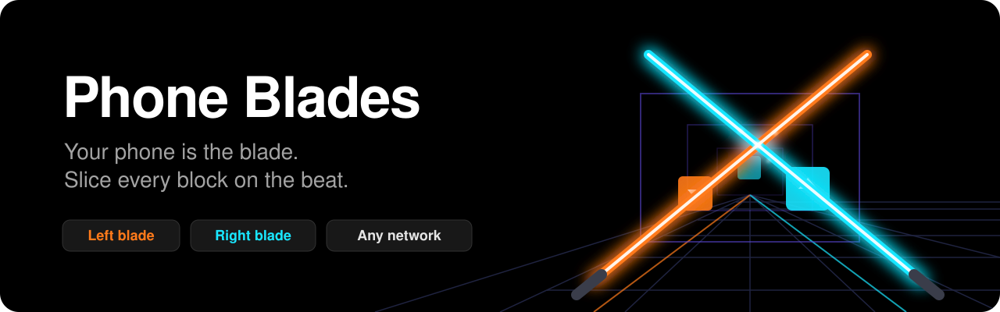
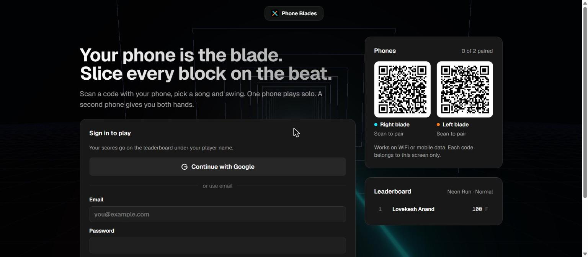
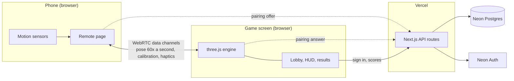

<p align="center">
  
</p>

<p align="center">
  <strong>A rhythm slicing game where your phone is the controller.</strong><br />
  Open it on a computer or TV, scan a code with your phone, and swing to the beat. No headset, no app install.
</p>

<p align="center">
  <a href="https://phone-blades.vercel.app"><strong>Play now</strong></a> ·
  <a href="#getting-started">Run locally</a> ·
  <a href="#how-it-works">How it works</a>
</p>

<p align="center">
  
  
  
  
  
  
  
</p>

---

<p align="center">
  
</p>

## Features

- **Your phone is the blade.** The phone's motion sensors stream its orientation to the game screen, where it becomes a glowing blade in a 3D scene.
- **Solo or dual.** One phone plays a single centre blade across every lane. Pair a second phone and the game switches to dual blades, orange for the left hand and cyan for the right. It adapts live, even mid song.
- **Plays over any network.** Phones connect straight to the game screen over a WebRTC data channel, on the same WiFi or on mobile data. Every screen generates its own private pairing codes.
- **Guided calibration.** Each phone is calibrated in two moves: aim at the middle of the screen, then at its right edge. A level check prevents sideways calibrations, and phones that report turns in reverse are detected and corrected.
- **Per phone sensitivity.** A slider from 50% to 150% on each phone, remembered on that device.
- **Your own music.** Choose a folder of MP3, M4A or WAV files once. Every song is beat tracked in the browser, gets a tempo, length and suggested difficulty, and never leaves your computer.
- **A built in soundtrack.** Neon Run is synthesised live, so the game works with no music at all.
- **Accounts and a leaderboard.** Sign in with Google or email. Each song and difficulty has its own top ten.
- **Proper game feel.** Three difficulties, bombs, an energy bar, combo multipliers, swing speed scoring, S to F ranks, bloom, blade trails, sparks and haptic feedback on Android.

## How to play

1. Open **[phone-blades.vercel.app](https://phone-blades.vercel.app)** on a computer or TV and sign in.
2. Scan the **Right blade** code with your phone and tap **Pair this phone**.
3. Hold the phone like a sword handle, with the top edge as the blade, and follow the two calibration steps.
4. Optionally scan the **Left blade** code with a second phone.
5. Pick a song and difficulty, then press **Play**. Swing through each block in the direction of its arrow, in the matching colour, and avoid the bombs.

Tap anywhere on the phone to recenter while aiming at the screen. Press <kbd>Esc</kbd> on the computer to pause. With no phone paired, the mouse moves the blade for practice runs, which are not ranked.

## How it works



- **Pairing.** The game screen creates a random code for each blade and shows it as a QR code. The phone opens a WebRTC offer for that code through `/api/signal`, the screen answers it, and from then on the two talk directly. Neon only holds the short lived handshake.
- **Low latency motion.** Orientation travels on an unordered channel with no retransmits, so a late pose is dropped rather than queued. The screen smooths the blade adaptively, steady when your hand is still and close to raw during fast swings, and predicts a few milliseconds ahead to hide network delay.
- **Slicing.** Each frame the blade is swept between its last two poses and tested against every block, so fast swings cannot pass through without a hit. A cut counts when the colour matches, the tip moves fast enough, and the swing follows the arrow.
- **Beat tracking.** Songs are decoded with the Web Audio API and turned into an onset envelope. The tempo comes from autocorrelation, refined with a fine grid search over period and phase, then each beat is nudged toward nearby onsets. Loudness per beat shapes how busy each section is. A five minute song is analysed in under 100 ms.

## Tech stack

| Area | Choice |
| --- | --- |
| Framework | Next.js 16 (App Router), React 19, TypeScript |
| Styling | Tailwind CSS 4, Geist and Geist Mono, Phosphor icons |
| 3D and audio | three.js with bloom post processing, Web Audio API |
| Realtime | WebRTC data channels, STUN, optional TURN |
| Data | Neon serverless Postgres |
| Auth | Neon Auth (email and Google) |
| Hosting | Vercel |
| Tests | Node test runner via `tsx` |

## Getting started

### Prerequisites

- Node.js 20.9 or newer
- A Vercel account with a Neon database connected to the project (it also provides Neon Auth)
- The Vercel CLI: `npm i -g vercel`

### Setup

```bash
git clone https://github.com/LovekeshAnand/phone-blade.git
cd phone-blade
npm install

vercel link          # connect the folder to your Vercel project
vercel env pull      # writes .env.local with the Neon variables
```

Then add a cookie secret for Neon Auth to `.env.local` (and to your Vercel project for deployments):

```bash
NEON_AUTH_COOKIE_SECRET="$(node -e "console.log(require('crypto').randomBytes(32).toString('base64url'))")"
```

In the Neon console, under **Auth**, add your site address as a trusted domain and enable Google if you want Google sign in.

### Scripts

| Command | What it does |
| --- | --- |
| `npm run dev` | Start the development server at http://localhost:3000 |
| `npm run build` | Production build |
| `npm start` | Serve the production build |
| `npm test` | Run the test suite |
| `npm run lint` | Lint with ESLint |

Phone motion sensors only work on secure (https) pages, so test phones against a deployed URL such as a Vercel preview. The game screen itself works on localhost.

### Environment variables

| Variable | Required | Purpose |
| --- | --- | --- |
| `DATABASE_URL` | Yes | Neon Postgres connection string. Added by the Neon integration. |
| `NEON_AUTH_BASE_URL` | Yes | Neon Auth endpoint. Added by the Neon integration. |
| `NEON_AUTH_COOKIE_SECRET` | Yes | At least 32 random characters used to sign session cookies. |
| `TURN_URLS` | No | Comma separated TURN server URLs, for networks that block direct connections. |
| `TURN_USERNAME` | No | TURN username. |
| `TURN_CREDENTIAL` | No | TURN password or credential. |

Database tables (`signals` and `scores`) are created automatically on first use.

## Project structure

```text
app/
  page.tsx                  One URL for everyone: phones get the remote, computers get the game
  api/signal/route.ts       WebRTC pairing mailbox
  api/ice/route.ts          STUN and TURN servers for the connection
  api/scores/route.ts       Leaderboard read and score submission
  api/auth/[...path]/       Neon Auth handler
components/
  Game.tsx                  Engine and pairing lifecycle, HUD, pause and results
  Lobby.tsx                 Song list, difficulty, phone pairing, sign in, leaderboard
  Remote.tsx                Phone controller with guided calibration and sensitivity
  ui.tsx                    Shared button, panel and skeleton components
lib/
  engine.ts                 three.js scene, blades, blocks, slicing and scoring
  orientation.ts            Phone attitude to blade direction, calibration maths
  calibration.ts            Steadiness, tilt and turn checks for the guided setup
  rtc.ts                    WebRTC pairing for the game screen and the phone
  beatmap.ts                Difficulty settings and the live block generator
  track.ts                  Beat tracking, song loading, difficulty suggestion
  audio.ts                  Synthesised soundtrack and sound effects
  songs.ts                  Local music folder access, remembered by the browser
  db.ts                     Neon client and schema
  auth/                     Neon Auth server and client
  game.test.ts              Tests
docs/                       README images
```

## Tuning

The feel of the blade is controlled by a few constants at the top of `lib/engine.ts`:

| Constant | Default | Effect |
| --- | --- | --- |
| `SMOOTH_MIN` | `0.4` | Smoothing while the hand is still. Lower is steadier but slower. |
| `SMOOTH_GAIN` | `8` | How quickly smoothing falls away during fast swings. |
| `PREDICT` | `0.012` | Seconds of motion prediction. Higher hides more delay but overshoots. |
| `MIN_SWING` | `2.0` | Tip speed in metres per second needed for a clean cut. |
| `BLADE` | `1.25` | Blade reach in metres. |

Difficulty settings (tempo, block speed, density, bombs) live in `lib/beatmap.ts`.

## Testing

```bash
npm test
```

The suite covers the phone to blade orientation maths, calibration and sensitivity, the guided calibration checks (including the upright pose that used to cause sideways calibrations), beatmap generation for solo and dual play, beat tracking on synthetic songs at several tempos, and difficulty suggestions.

## Known limitations

- Some mobile carriers block direct peer connections. Set the `TURN_*` variables to relay through a TURN server for those networks.
- Scores are computed in the player's browser. The API rejects impossible values, but a determined player could still submit a fake score.
- Beat tracking assumes a steady tempo, so live recordings and medleys can drift off the beat.
- Remembering the music folder needs Chrome or Edge. Other browsers ask for the songs each visit.

## License

Released under the [MIT License](LICENSE). Copyright © 2026 Lovekesh Anand.

Bring your own music: only use songs you have the rights to play.
